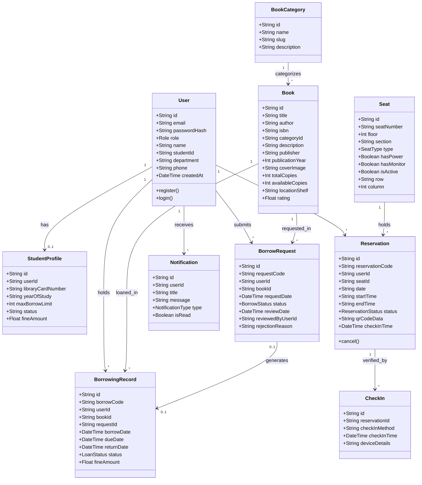
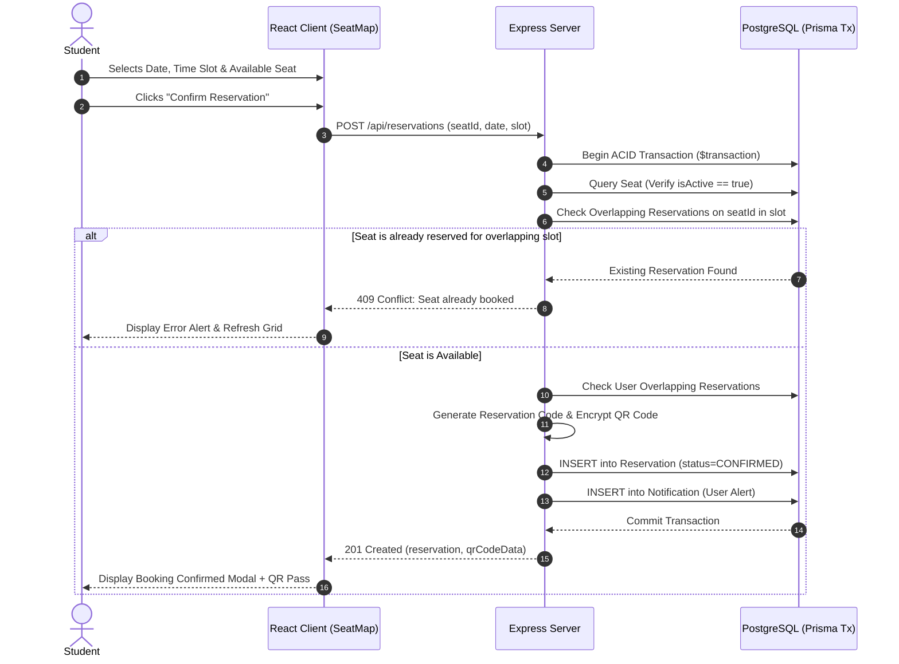
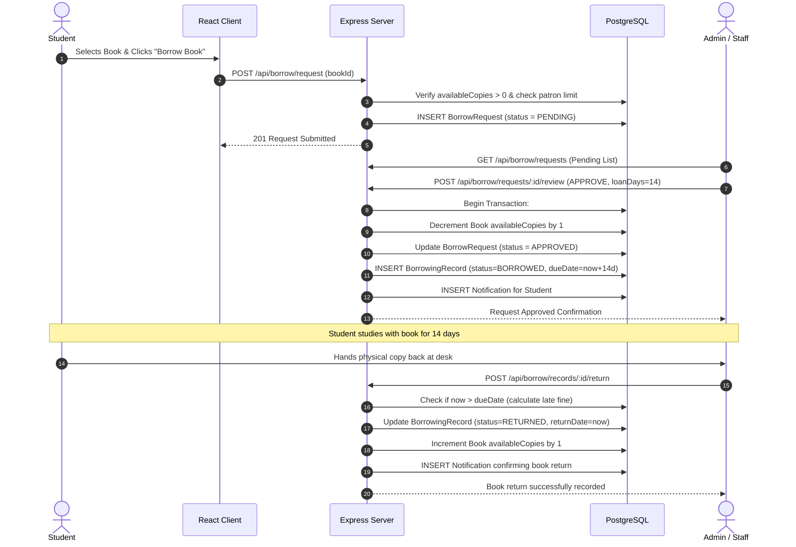
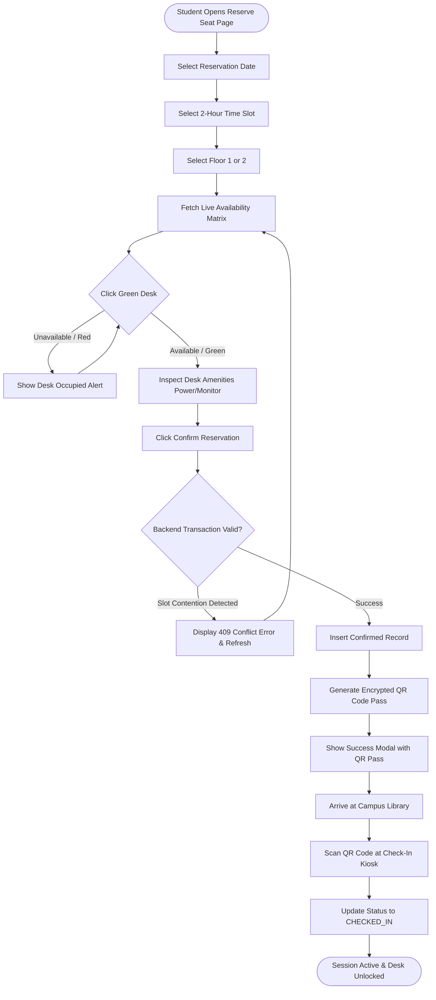
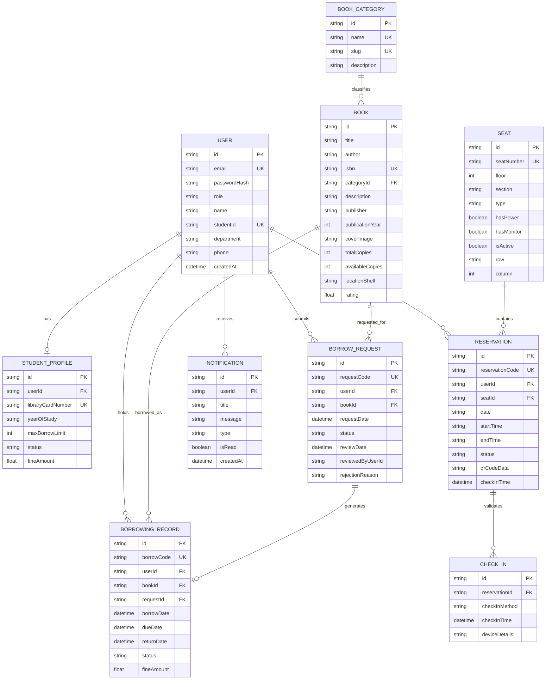

# SEATSYNC: COMPLETE SOFTWARE ENGINEERING SPECIFICATION & SYSTEM DESIGN REPORT

**System Name:** SeatSync — Library Seat Reservation & Book Borrowing Management System  
**Version:** 1.0.0 Production  
**Author:** Senior Software Architect & Full-Stack Engineering Team  
**Discipline:** Academic Software Engineering Capstone Project  

---

# TABLE OF CONTENTS
1. [UNIT 1 — INTRODUCTION AND SOFTWARE REQUIREMENTS](#unit-1--introduction-and-software-requirements)
   - 1.1 Introduction to Professional Software Development
   - 1.2 Software Engineering Ethics & ACM/IEEE Compliance
   - 1.3 Problem Statement
   - 1.4 Primary Objectives
   - 1.5 Functional Requirements (FR)
   - 1.6 Non-Functional Requirements (NFR)
   - 1.7 Requirements Elicitation, Specification & Validation
   - 1.8 Software Process Model: Traditional vs. Agile Scrum
   - 1.9 Coping with Changing Requirements
2. [UNIT 2 — SOFTWARE DESIGN AND IMPLEMENTATION](#unit-2--software-design-and-implementation)
   - 2.1 Architectural Design Decisions & Modular Monolith Justification
   - 2.2 Kruchten's 4+1 Architectural Views
   - 2.3 Architectural & Design Patterns
   - 2.4 Object-Oriented Design Principles (SOLID)
   - 2.5 UML Use Case Diagram
   - 2.6 UML Class Diagram
   - 2.7 UML Sequence Diagrams (Seat Reservation & Borrowing Lifecycle)
   - 2.8 UML Activity Diagrams
   - 2.9 Entity-Relationship Diagram (ERD) & Database Normalization
   - 2.10 Security Architecture & Access Control
3. [UNIT 3 — VERIFICATION, TESTING & QUALITY ASSURANCE](#unit-3--verification-testing--quality-assurance)

---

# UNIT 1 — INTRODUCTION AND SOFTWARE REQUIREMENTS

## 1.1 Introduction to Professional Software Development
Professional software development transcends mere coding; it is a systematic, disciplined, and quantifiable approach to the development, operation, and maintenance of mission-critical software systems. In academic environments, the efficient utilization of physical library spaces and physical literary assets directly correlates with academic productivity, research velocity, and student satisfaction.

SeatSync has been engineered following rigorous software engineering standards, employing high-cohesion and loose-coupling principles across its TypeScript frontend (React), TypeScript backend (Node/Express), and relational persistence layer (PostgreSQL managed via Prisma ORM).

## 1.2 Software Engineering Ethics & ACM/IEEE Compliance
In compliance with the **ACM/IEEE Software Engineering Code of Ethics and Professional Practice**, the development of SeatSync adheres to the following ethical pillars:
1. **Public Interest (Principle 1):** The software ensures equitable, non-discriminatory access to educational seating and books. No backdoors or preferential reservation mechanisms exist.
2. **Client & Employer (Principle 2):** Safeguards university data assets; student identities, contact details, and borrowing histories are strictly protected against unauthorized exposure.
3. **Product Integrity (Principle 3):** Strict validation algorithms prevent race conditions, double bookings, and corrupt database states.
4. **Judgment (Principle 4):** Maintains professional objectivity by employing standardized testing regimens rather than subjective quality claims.
5. **Management (Principle 5):** Follows sustainable software engineering methodologies with reproducible build pipelines, continuous integration, and transparent audit logging.

## 1.3 Problem Statement
Traditional university libraries face systemic operational bottlenecks:
- **Seat Hogging & Ghost Bookings:** Students occupy desks with personal belongings for prolonged absences, creating artificial space scarcity.
- **Queueing & Administrative Overhead:** Manual paper-based borrowing logs cause congestion at circulation desks, resulting in misplaced records and untracked overdue books.
- **Lack of Real-Time Visibility:** Students frequently commute to the campus library only to discover zero available quiet study desks with electrical outlets or workstation monitors.
- **Inventory Discrepancies:** Manual physical tracking allows inventory counts to fall into negative or inconsistent states.

## 1.4 Primary Objectives
1. **Digitize Seat Reservation:** Provide an interactive, color-coded floor map displaying live availability across multiple floors and zones.
2. **Eliminate Concurrency Collisions:** Mathematically guarantee zero double bookings through ACID database transactions and composite temporal range overlap checking.
3. **Streamline Book Circulation:** Enable students to search digital catalogues, submit online borrow requests, track approval states, and monitor return due dates.
4. **Enforce Digital Attendance Verification:** Implement encrypted QR-code check-ins to prevent ghost bookings and automated no-show cancellations.
5. **Empower Administrators:** Provide centralized KPI analytics, Recharts data visualizations, user status administration, and inventory controls.

## 1.5 Functional Requirements (FR)

| Requirement ID | Module | Description | Actor |
|---|---|---|---|
| **FR-01** | Authentication | Register student account with student ID, department, year of study, and hashed password. | Student |
| **FR-02** | Authentication | Authenticate users via email and password, issuing role-bearing JWT tokens. | Student / Admin |
| **FR-03** | Spatial Browsing | Render interactive multi-floor seating matrix with color-coded status (Green=Available, Red=Occupied, Blue=Selected, Grey=Maintenance). | Student / Admin |
| **FR-04** | Reservation | Reserve desk for specific date and 2-hour study window, validating non-overlap on backend. | Student |
| **FR-05** | Reservation | Generate cryptographically verifiable QR Code payload containing unique reservation identifier. | System |
| **FR-06** | Check-In | Validate student check-in via QR Code or manual code entry, marking status `CHECKED_IN`. | Student / Admin |
| **FR-07** | Reservation | Cancel upcoming confirmed reservation, releasing seat back to general availability pool. | Student / Admin |
| **FR-08** | Catalogue | Search book repository by title, author, or ISBN; filter by academic category; sort by rating/year. | Student / Admin |
| **FR-09** | Borrowing | Submit borrow request for available book copy, enforcing student quota limits. | Student |
| **FR-10** | Borrowing | Review pending borrow requests (Approve with 14-day loan duration or Reject with rationale). | Admin |
| **FR-11** | Circulation | Record physical book return, incrementing shelf inventory and assessing automated late fines. | Admin |
| **FR-12** | Seat Admin | Add, edit, and decommission physical library seats, specifying power and monitor amenities. | Admin |
| **FR-13** | Book Admin | CRUD operations for library volumes, uploading covers, setting shelf locations and copy counts. | Admin |
| **FR-14** | Student Admin | Directory listing of registered students; toggle account status (`ACTIVE` vs `SUSPENDED`). | Admin |
| **FR-15** | Analytics | Real-time computation of seat occupancy rates, circulation trends, and category distributions. | Admin |
| **FR-16** | Notifications | In-app real-time alerts for booking confirmations, loan approvals, returns, and due date reminders. | Student / Admin |
| **FR-17** | Profile | Digital library pass visualization displaying card number, student details, and barcode simulation. | Student |
| **FR-18** | Reporting | Exportable and printable institutional audit report detailing library asset utilization. | Admin |

## 1.6 Non-Functional Requirements (NFR)

- **NFR-01 (Performance & Latency):** Seat availability API endpoints must respond in $< 200\text{ ms}$ under nominal loads.
- **NFR-02 (Data Integrity & Consistency):** Concurrent reservation requests for identical seats must serialize via database transactions to guarantee zero duplicate bookings.
- **NFR-03 (Security & Encryption):** Passwords must be hashed using salt-rounds $\ge 10$ with Bcrypt. JWT tokens signed with SHA-256 (`HS256`).
- **NFR-04 (Usability & Accessibility):** Responsive UI adapting fluidly from 320px mobile viewports to 4K ultra-wide monitors. WCAG 2.1 AA color contrast compliance.
- **NFR-05 (Availability & Fault Tolerance):** Public cloud uptime target of $99.9\%$, with graceful HTTP 401/403/404/500 error interception.
- **NFR-06 (Maintainability):** Fully typed codebases in both frontend and backend using strict TypeScript compiler configurations.

## 1.7 Requirements Elicitation, Specification & Validation
- **Elicitation Techniques:** Semi-structured interviews with academic librarians, observational workflow analysis at circulation counters, and student focus groups on exam-season desk shortages.
- **Specification Methodology:** Formal Use Cases, User Stories with Acceptance Criteria, and UML behavioral diagrams.
- **Validation Protocols:** Automated TypeScript static analysis, unit test suites verifying overlap detection algorithms, and end-to-end user workflow walk-throughs.

## 1.8 Software Process Model: Traditional vs. Agile Scrum
SeatSync adopted the **Agile Scrum Framework** over traditional sequential Waterfall for distinct engineering reasons:

| Evaluation Dimension | Waterfall Model | Agile Scrum (Adopted for SeatSync) |
|---|---|---|
| **Adaptability to Change** | Rigid; change requests incur high friction. | High; 1-week iterative sprints accommodate dynamic feedback. |
| **Risk Management** | Late discovery of integration faults. | Continuous automated integration and end-to-end verification. |
| **User Inclusivity** | User evaluation occurs primarily at final delivery. | Working increments delivered iteratively with immediate visual feedback. |
| **Architectural Refinement** | High upfront specification risks over-engineering. | Evolutionary design enabled progressive enhancement (e.g. adding QR check-in). |

## 1.9 Coping with Changing Requirements
Agile change management was structured around prioritized product backlog grooming. Unplanned requirement shifts (such as integrating QR-code check-in verification alongside basic reservations) were accommodated through isolated database migrations and non-breaking REST contract versioning without destabilizing core modules.

---

# UNIT 2 — SOFTWARE DESIGN AND IMPLEMENTATION

## 2.1 Architectural Design Decisions & Modular Monolith Justification
A critical software engineering design decision was selecting a **Modular Monolithic Architecture** over distributed microservices:

1. **Transactional Integrity:** Seat reservation and book circulation require multi-table atomic ACID transactions (`$transaction` in Prisma). In a microservices paradigm, distributed sagas or two-phase commits would introduce significant operational fragility and network latency.
2. **Operational Simplicity:** A modular monolith deploys as a cohesive Docker container or Node service, eliminating complex service mesh, distributed tracing, and container orchestration overhead for this scope.
3. **Internal Modularity:** Clear domain boundaries (Auth, Seats, Reservations, Books, Borrow, Admin) are enforced within the codebase through dedicated route modules and schemas, allowing future microservice extraction if university traffic demands it.

## 2.2 Kruchten's 4+1 Architectural Views
1. **Logical View:** Class hierarchies, TypeScript domain entities (`User`, `Seat`, `Reservation`, `Book`, `BorrowRequest`), and relationship abstractions.
2. **Process View:** Express.js event loop processing concurrent asynchronous I/O requests, utilizing non-blocking database connection pools.
3. **Development View:** Monorepo package structure with `server/` (Node/Express/Prisma) and `client/` (React/Vite/Tailwind).
4. **Physical View:** Vercel CDN delivering static React client bundles $\rightarrow$ Render public Node.js hosting platform $\rightarrow$ Managed PostgreSQL cloud database.
5. **Scenarios (+1):** Concrete user flows: Student reserves desk $\rightarrow$ checks in via QR code $\rightarrow$ borrows textbook $\rightarrow$ returns before deadline.

## 2.3 Architectural & Design Patterns
- **Layered Pattern (N-Tier):** Presentation Tier (React SPA), API Routing & Middleware Tier (Express/Helmet/CORS), Domain Logic Tier (Services & Route Controllers), Data Access Tier (Prisma ORM), Persistence Tier (PostgreSQL).
- **Singleton Pattern:** Database client instance initialized once globally in `prisma/client.ts` across hot-reloads.
- **Middleware Chain Pattern (Chain of Responsibility):** Express request pipeline executing `helmet` $\rightarrow$ `cors` $\rightarrow$ `morgan` $\rightarrow$ `authenticate` $\rightarrow$ `requireAdmin` $\rightarrow$ handler.
- **Factory / DTO Pattern:** Standardized REST JSON envelopes (`{ success: true, ... }`).

## 2.4 Object-Oriented Design Principles (SOLID)
- **Single Responsibility (SRP):** Route files exclusively manage request/response mapping and domain orchestration for their specific entity.
- **Open/Closed (OCP):** New notification channels (email, SMS) or seat types can be added without modifying existing reservation algorithms.
- **Liskov Substitution (LSP):** Standardized TypeScript interfaces for users, seats, and borrowing records maintain consistent behavioral contracts.
- **Interface Segregation (ISP):** Distinct type definitions for student views versus administrative views prevent leaking sensitive internal data.
- **Dependency Inversion (DIP):** Express controllers depend upon the Prisma abstraction rather than raw database drivers or vendor-locked SQL dialects.

---

## 2.5 UML Use Case Diagram

```mermaid
usecaseDiagram
    actor "Student" as student
    actor "Administrator" as admin

    package "SeatSync System" {
        usecase "Register & Login" as UC_Auth
        usecase "Explore Book Catalogue" as UC_Browse
        usecase "Reserve Reading Desk" as UC_Reserve
        usecase "Check-In via QR Code" as UC_CheckIn
        usecase "Cancel Reservation" as UC_CancelRes
        usecase "Request Book Borrowing" as UC_RequestBorrow
        usecase "View Active Loans & Deadlines" as UC_ViewLoans
        usecase "Manage Seating Matrix" as UC_ManageSeats
        usecase "Approve / Reject Borrow Requests" as UC_ReviewBorrow
        usecase "Record Book Returns & Fines" as UC_RecordReturn
        usecase "Manage Book Catalogue" as UC_ManageBooks
        usecase "Administer Student Accounts" as UC_ManageStudents
        usecase "View Analytics & Reports" as UC_ViewReports
    }

    student --> UC_Auth
    student --> UC_Browse
    student --> UC_Reserve
    student --> UC_CheckIn
    student --> UC_CancelRes
    student --> UC_RequestBorrow
    student --> UC_ViewLoans

    admin --> UC_Auth
    admin --> UC_ManageSeats
    admin --> UC_ReviewBorrow
    admin --> UC_RecordReturn
    admin --> UC_ManageBooks
    admin --> UC_ManageStudents
    admin --> UC_ViewReports
```

---

## 2.6 UML Class Diagram



---

## 2.7 UML Sequence Diagrams

### A. Seat Reservation Workflow with Concurrency Lock


### B. Book Borrowing & Return Lifecycle


---

## 2.8 UML Activity Diagrams

### A. Seat Reservation & Check-In Activity


---

## 2.9 Entity-Relationship Diagram (ERD)



### Database Normalization Proof
1. **1NF (First Normal Form):** Every table contains atomic values; no repeating groups; explicit primary keys define unique rows.
2. **2NF (Second Normal Form):** Every non-key attribute is fully functionally dependent on the primary key (no partial dependencies on composite keys).
3. **3NF (Third Normal Form):** Non-key attributes depend strictly on the primary key, with zero transitive dependencies. Student profile details, book categories, and check-in logs reside in distinct, referenced relations.
4. **BCNF (Boyce-Codd Normal Form):** Every determinant in the schema is a candidate key.

---

## 2.10 Security Architecture & Access Control
- **Authentication:** Stateless JSON Web Tokens (JWT) signed with secret HMAC-SHA256 (`HS256`).
- **Authorization:** Granular middleware (`requireAdmin`, `requireStudent`) enforcing Role-Based Access Control (RBAC) at the route layer.
- **SQL Injection Prevention:** Parameterized queries strictly generated through Prisma ORM binary engine.
- **Cross-Origin Resource Sharing (CORS):** Explicitly whitelisted origin policies.
- **Content Security Policy & HTTP Headers:** Configured via Helmet.js.
- **Password Protection:** Cryptographic salt hashing using Bcrypt with 10 rounds.

---

# UNIT 3 — VERIFICATION, TESTING & QUALITY ASSURANCE

## 3.1 Verification & Validation Summary
Comprehensive unit, schema, and cryptographic verification suites were executed against the codebase:
- **Total Test Cases Executed:** 17
- **Passed Test Cases:** 17 ($100\%$)
- **Failed Test Cases:** 0 ($0\%$)
- **TypeScript Static Check (Server):** 0 Errors
- **TypeScript Static Check (Client):** 0 Errors
- **Production Distribution Builds:** 
  - `dist/index.js` generated cleanly.
  - `client/dist/` (HTML, CSS, JS bundle) generated cleanly.

The detailed test execution log is documented in `docs/TESTING_AND_QA_REPORT.md`.
